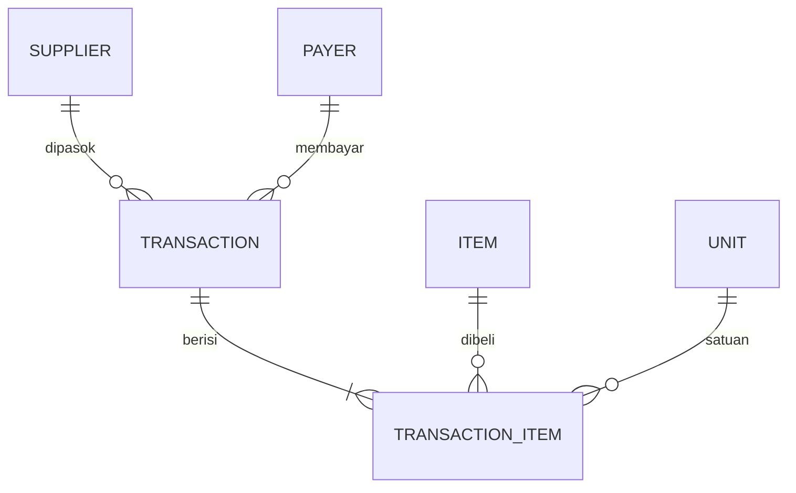

# ATHERA ADMIN WEB — Project Plan

Web app admin untuk mencatat pengeluaran cafe/resto: scan struk dengan AI, simpan ke database relasional yang terjaga integritasnya, rekap, dan export CSV.

## 1. Tujuan
- Ganti Google Sheets manual (3 sheet) dengan satu sistem yang konsisten.
- Input struk cepat: foto → AI ekstrak → review manusia → simpan.
- Data punya integritas (tidak ada typo supplier/satuan, tidak ada total yang tidak cocok).
- Robust tapi mudah dipakai.

## 2. Prinsip
1. **Human-in-the-loop**: AI hanya mengisi draft; user wajib review sebelum simpan.
2. **Satu sumber kebenaran**: database. Sheets/CSV hanya hasil export.
3. **Validasi di server**, bukan hanya di UI.
4. **Siap online**: deploy ke Vercel, database cloud, mudah di-backup/export.
5. **Sederhana**: sedikit layar, sedikit klik.

## 3. Tech Stack
Target deploy: **Vercel (`*.vercel.app`)**.

> **Penting**: Vercel itu serverless, filesystem-nya tidak permanen. Jadi **SQLite lokal dan simpan foto di folder TIDAK bisa dipakai**. Database dan penyimpanan foto harus layanan eksternal.

| Layer | Pilihan | Alasan |
|---|---|---|
| Framework | Next.js (App Router) | Native di Vercel, frontend + API route satu repo |
| Database | Postgres (Neon via Vercel Marketplace) | Relasional, FK/constraint kuat, ada free tier |
| ORM | Drizzle (atau Prisma) | Skema + migrasi type-safe |
| Foto struk | Vercel Blob (atau Supabase Storage) | File permanen, URL privat |
| Auth | Login sederhana (lihat §9) | Cukup untuk 1 pemilik / tim kecil |
| OCR/AI | Gemini API (model Flash) + JSON Schema | Output terstruktur, murah |
| CSV | `papaparse` / `csv-stringify` | Import data lama & export |
| Styling | CSS biasa (CSS variables dari DESIGN.md) | Tanpa Tailwind |

> Catatan: harga dan kuota free tier Gemini, Neon, dan Vercel bisa berubah. Cek halaman pricing resmi sebelum mengandalkannya. App tetap harus bisa dipakai tanpa AI (input manual).
> Model data di §4 ditulis dengan istilah SQLite, tapi konsepnya sama untuk Postgres (uang tetap integer, FK + CHECK constraint).

## 4. Model Data



### Tabel
- **suppliers**: `id`, `name` (UNIQUE, case-insensitive), `address`, `phone`, `notes`, `is_active`, `created_at`
- **supplier_aliases**: `id`, `supplier_id`, `alias` (UNIQUE) — nama variasi dari struk/data lama → supplier resmi
- **payers**: `id`, `name` (UNIQUE) — siapa yang membayar (Owner, Kasir, Petty Cash, dll)
- **units**: `id`, `code` (UNIQUE: kg, gr, l, ml, pcs, pack, botol, ikat, dus), `name`
- **items**: `id`, `name` (UNIQUE), `default_unit_id`, `category`
- **transactions**: `id`, `date`, `supplier_id` (FK), `payer_id` (FK), `title`, `total_amount`, `receipt_image_path`, `source` (`manual` | `ai` | `import`), `created_at`
- **transaction_items**: `id`, `transaction_id` (FK, ON DELETE CASCADE), `item_id` (FK), `qty`, `unit_id` (FK), `unit_price`, `subtotal`

### Aturan Integritas
- Semua FK `ON` enforce (`PRAGMA foreign_keys = ON`).
- `qty > 0`, `unit_price >= 0`, harga disimpan sebagai **integer Rupiah** (tanpa float).
- `subtotal = round(qty * unit_price)` dihitung ulang di server.
- `transactions.total_amount` = jumlah `subtotal` item; jika beda → tolak/peringatkan.
- Supplier, item, dan satuan hanya boleh dipilih dari master (atau dibuat lewat flow "tambah baru").
- Supplier yang sudah punya transaksi tidak bisa dihapus (hanya dinonaktifkan).
- Deteksi duplikat: peringatan jika tanggal + supplier + total sama dengan transaksi yang ada.
- Semua simpan transaksi dalam **satu DB transaction** (header + item all-or-nothing).

## 5. Fitur

### MVP (Fase 1–3)
1. **Master Supplier**: CRUD, alamat, no HP, link WhatsApp.
2. **Master Satuan, Pembayar, Item**.
3. **Input Transaksi Manual**: form header + baris item dinamis.
4. **Daftar & Rekap**: filter bulan, pembayar, supplier; total per bulan.
5. **Rekap Detail Item**: per item/per supplier, tren harga.
6. **Import CSV data lama** (lihat §7).
7. **Export CSV**.

### Fase 4: AI Scan
- Upload/foto struk → server panggil Gemini dengan JSON Schema → draft form.
- Layar review split: foto struk (zoom) kiri, form draft kanan.
- Auto-match supplier/item/satuan ke master (via alias + fuzzy); jika tidak ketemu, tawarkan "Tambah baru".
- Tampilkan peringatan jika total struk ≠ jumlah item.

### Fase 5: Polish
- Backup database satu klik, audit log sederhana, shortcut keyboard, PWA/mobile-friendly.

## 6. Struktur Folder
```
ATHERA_ADMIN_WEB/
├── PROJECT.md
├── DESIGN.md
├── package.json
├── .env.local            # secret lokal (jangan di-commit)
├── drizzle/              # migrasi SQL
├── src/
│   ├── app/
│   │   ├── login/
│   │   ├── (app)/        # halaman terproteksi: transaksi, supplier, rekap, import
│   │   ├── api/          # route handler: transactions, suppliers, import, export, ai
│   │   └── globals.css   # CSS variables dari DESIGN.md
│   ├── db/               # schema.ts, koneksi
│   ├── lib/              # auth.ts, gemini.ts, csv.ts, validation.ts, matching.ts
│   └── middleware.ts     # cek sesi untuk semua halaman & API
└── imports/              # contoh CSV lama (jangan berisi data sensitif jika di-commit)
```

## 7. Import Data Lama (Rencana)
Alur aman, bukan sekali tembak:
1. **Export** tiap sheet Google Sheets ke CSV (File → Download → CSV), satu file per sheet.
2. Upload lewat halaman **Import** (file diproses di server, tidak disimpan permanen).
3. **Mapping kolom**: UI menampilkan kolom CSV vs field tujuan.
4. **Dry-run / Preview**: sistem menampilkan
   - baris valid,
   - baris bermasalah (tanggal tidak valid, harga bukan angka, qty kosong),
   - nama supplier/satuan yang tidak dikenal.
5. **Resolusi nama**: user memetakan variasi ("Tk. Berkah", "Toko Berkah") ke satu supplier master → disimpan sebagai alias.
6. **Commit**: impor dalam satu DB transaction, `source = 'import'`, bisa rollback per batch.

Urutan impor: **Supplier → Item/Satuan → Transaksi → Detail Item**.

Penanganan format Indonesia: tanggal `dd/mm/yyyy`, angka `1.250.000` / `Rp 1.250.000`, desimal koma `2,5`.

## 8. Roadmap
| Fase | Isi | Hasil |
|---|---|---|
| 0 | Setup Next.js, Postgres, skema, login, deploy awal ke Vercel | Aplikasi online dan terproteksi |
| 1 | Master supplier/satuan/pembayar/item | Master data siap |
| 2 | Import CSV data lama | Data lama masuk dan bersih |
| 3 | Input manual, daftar, rekap, export | Pengganti Sheets sudah dapat dipakai |
| 4 | AI scan struk + review | Input cepat |
| 5 | Backup, polish, mobile | Siap harian |

Langkah pertama: **Fase 0 → 1 → 2** (agar data lama langsung masuk).

## 9. Otorisasi, Keamanan & Operasional
Data keuangan di URL publik **wajib** diproteksi. Semua halaman dan API dicek di `middleware`, bukan hanya disembunyikan di UI.

**Pilihan otorisasi** (pilih satu):
| Opsi | Cara | Cocok untuk |
|---|---|---|
| A. Password bersama | 1 password di env, cookie sesi bertanda tangan (httpOnly, secure, expire) | Cuma lu sendiri / partner dekat. **Paling simpel.** |
| B. Akun per user | Email + password (hash argon2/bcrypt), tabel `users`, peran owner/staff | Tim, butuh tahu siapa input apa |
| C. Login Google (allowlist email) | OAuth, hanya email tertentu yang boleh | Tanpa kelola password |

Rekomendasi awal: **A**, lalu naik ke B/C kalau tim bertambah. Sertakan rate-limit percobaan login.

**Lainnya:**
- Secret (`GEMINI_API_KEY`, `DATABASE_URL`, `AUTH_SECRET`, `APP_PASSWORD`) hanya di Environment Variables Vercel, tidak pernah ke frontend/Git.
- Foto struk di storage privat, diakses lewat URL bertanda tangan / route terproteksi.
- Backup: export CSV rutin + fitur backup/PITR dari penyedia Postgres.
- Batas ukuran dan tipe file upload; kompres gambar sebelum kirim ke AI.
- Batasan Vercel: ukuran body request dan durasi function terbatas, jadi foto dikompres di browser lebih dulu, dan import CSV besar diproses per batch.
- Tambahkan `noindex` agar tidak muncul di Google.

## 10. Pertanyaan Terbuka
- [ ] Contoh kolom sebenarnya dari 3 sheet lama (header + 5 baris contoh).
- [ ] Daftar pembayar yang dipakai.
- [ ] Apakah satu transaksi Sheet 1 selalu punya rincian item di Sheet 2?
- [ ] Siapa saja pengguna? (menentukan opsi otorisasi A/B/C di §9)
- [ ] Mata uang selalu IDR?
